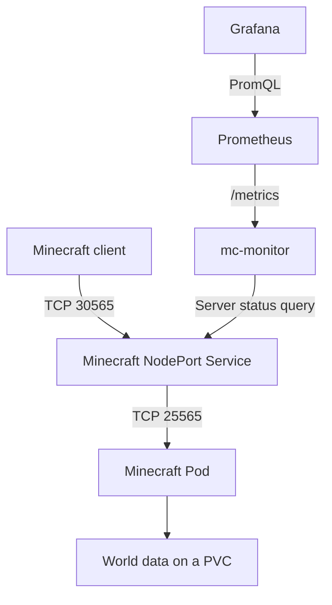
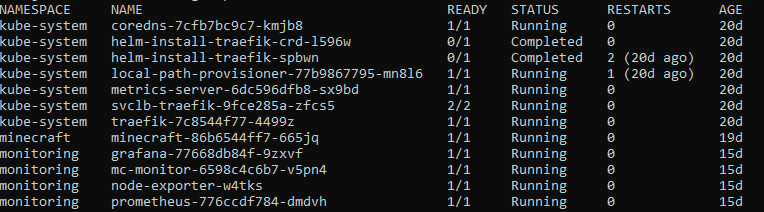
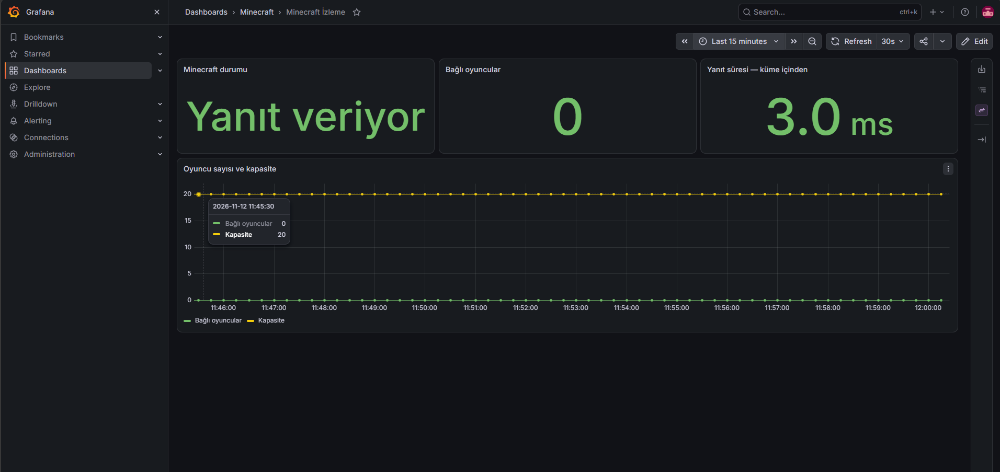

# Minecraft Server on K3s

I wanted to learn Kubernetes by running something I'd actually use, so I set up a Minecraft Java Edition server for friends on an Oracle Cloud VM. The project gave me a reason to work through the practical questions: where the world data goes, how players reach the server, and how to figure out what's wrong when they can't connect.

I added Prometheus and Grafana afterward to see when the server was responding and how many players were online.

## How it works

The server runs on a single K3s node: an ARM64 Ubuntu 24.04 VM with 2 OCPUs and 12 GB of RAM. A Kubernetes Deployment runs Minecraft Java Edition 26.2. The NodePort Service exposes TCP port 30565 on the node and forwards traffic to port 25565 in the Pod.

The world is stored on a 10 GiB persistent volume claim backed by K3s's `local-path` storage class. The data stays on the node's disk when Kubernetes replaces the Pod.



The game resources are in `kubernetes/minecraft/`. The exporter, Prometheus, Grafana, and dashboard configuration are in `kubernetes/monitoring/`. Keeping the dashboard in JSON means I can load the same panels again when I set up Grafana from scratch.

## Run the server

You'll need a K3s cluster with `kubectl` access and a `local-path` StorageClass. Run these commands from the repository root in a test cluster. If you accept the Minecraft EULA, set `EULA` to `TRUE` in `kubernetes/minecraft/minecraft-deployment.yaml`. The example starts with a fresh world.

```bash
kubectl get nodes
kubectl get storageclass local-path
kubectl create namespace minecraft --dry-run=client -o yaml | kubectl apply -f -
kubectl apply -f kubernetes/minecraft/
kubectl get pods,pvc,svc -n minecraft
```



Check that the `mc-data` claim is `Bound` and wait for `Done` in the Minecraft startup logs:

```bash
kubectl logs -f -n minecraft deployment/minecraft
```

In the Minecraft client, connect to `<SERVER_IP>:30565`. For access over the internet, allow TCP 30565 in the Oracle Cloud network rules and in the VM firewall if it filters this traffic. If your players have known IP ranges, restrict the rule to those ranges.

## Add monitoring

`mc-monitor` checks whether the game server responds and exposes the player count, capacity, and response time inside the cluster. Prometheus scrapes those metrics every 15 seconds. Grafana loads the dashboard from the JSON file in the repository.

Start with the exporter and Prometheus:

```bash
kubectl apply -f kubernetes/monitoring/mc-monitor.yaml
kubectl apply -f kubernetes/monitoring/prometheus.yaml
kubectl rollout status deployment/prometheus -n monitoring --timeout=120s
```

For a fresh Grafana install, run the next line in Bash on its own, then type a password and press Enter:

```bash
read -rsp 'Grafana admin password: ' GRAFANA_PASSWORD
```

Create the Secret that the Grafana Deployment references:

```bash
echo
test -n "$GRAFANA_PASSWORD" &&
  kubectl create secret generic grafana-admin -n monitoring \
    --from-literal=admin-password="$GRAFANA_PASSWORD"
unset GRAFANA_PASSWORD
```

Once the Secret is created, deploy Grafana and its dashboard with Kustomize:

```bash
kubectl apply -k kubernetes/monitoring/
kubectl rollout status deployment/grafana -n monitoring --timeout=120s
```

### Open the dashboard

On the K3s server, run the port forward and leave it open:

```bash
kubectl port-forward -n monitoring svc/grafana 3000:3000
```

From a second terminal on your computer, start an SSH tunnel. Replace the placeholders with your own connection details:

```bash
ssh -i "<SSH_KEY_PATH>" -N -L 127.0.0.1:13000:127.0.0.1:3000 "<SSH_USER>@<SERVER_IP>"
```

Open the [Minecraft dashboard](http://localhost:13000/d/minecraft-overview). On a fresh install, sign in as `admin` with the password you chose for the Secret.



In Grafana Explore, select Prometheus and run these queries:

| Query | What a result of `1` means |
| --- | --- |
| `up{job="minecraft"}` | Prometheus can scrape the exporter. |
| `minecraft_status_healthy{job="minecraft"}` | The exporter can reach the Minecraft server and get a response. |

You can also join the server and watch the player count change. The dashboard refreshes every 30 seconds.

## A connection problem I worked through

The first time I tried connecting from another computer, the TCP connection to port 30565 timed out. Minecraft responded from inside the cluster, so I ran `tcpdump` on the VM while trying the external connection again. I didn't see the connection attempt reach the VM. That gave me a concrete reason to check the Oracle Cloud ingress rules.

After I allowed TCP 30565 in the security rules, `Test-NetConnection` passed from Windows. Checking the service inside the cluster first helped me narrow down where to look.

## What's next

This setup runs on one node, so the world depends on that node's disk. I would keep a copy of the world outside the VM and add Node Exporter to track CPU, memory, and disk usage.

The repository contains the deployment and dashboard configuration. The world data, SSH keys, kubeconfig, and password values stay outside Git.
